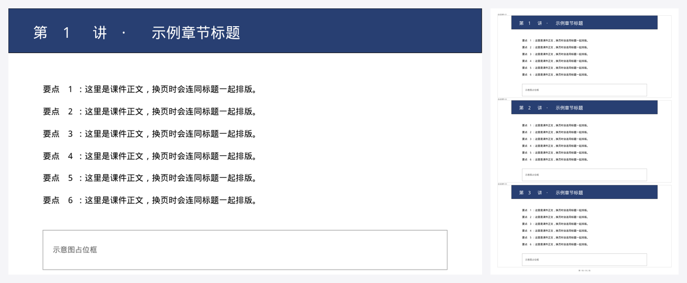
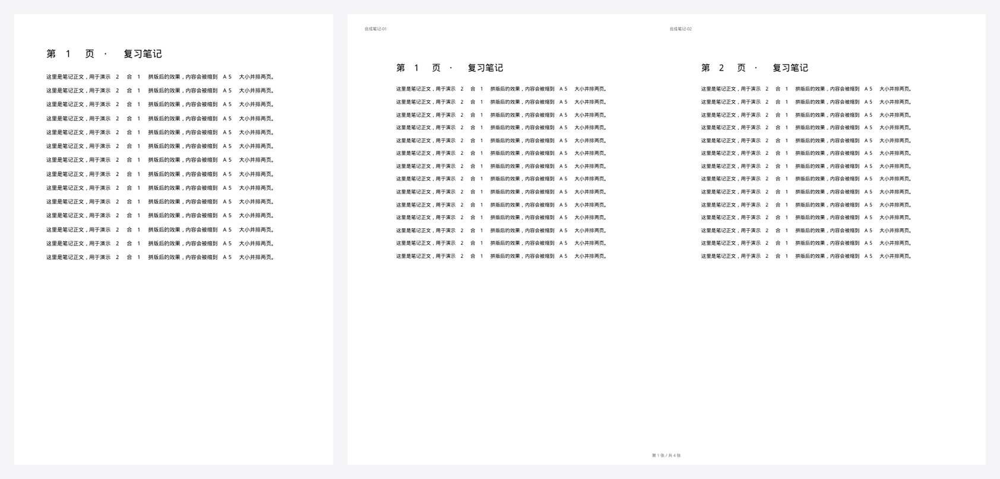

# PrePrintPDFProcessor-4P

**Turn any PDF into a paper-saving, print-friendly version — in one command.**

[](https://github.com/never-die-cold/PrePrintPDFProcessor-4P/actions/workflows/tests.yml)
[](LICENSE)

**中文说明见 [README.zh-CN.md](README.zh-CN.md)。**

Printing a 741-page slide bundle single-sided burns 741 sheets. Packed 3-up and duplexed it fits on **124 sheets (−83%)**, and the file is 30% smaller thanks to font subsetting and image downsampling.

| Before | After |
| --- | --- |
|  | 3 slides per A4 sheet, per-cell labels, footer, met: `--nup 3` |
|  | 2 pages side by side on one landscape A4: `--nup 2` (default) |

More samples: [booklet](docs/images/booklet.png) · [scanned-document cleanup](docs/images/scan-enhance.png) · [handout theme](docs/images/handout-theme.png)

## What it does

| | |
| --- | --- |
| **N-up imposition** | 2/3/4/6/8/9/12/16 pages per sheet. The grid and paper orientation are chosen automatically from the source aspect ratio (16:9 decks → 3-up portrait, documents → 2-up landscape). |
| **Paper-saving extras** | auto-trim empty margins and scale content up, per-cell labels (`L1-01…`), sheet footer, cut guides, `--pad-duplex` to keep double-sided prints aligned, `--rotate-back` for short-edge flipping. |
| **Ink saving** | `--gray` converts vectors to grayscale (text stays selectable); `--gray-raster` rasterizes; `--enhance` removes scan background and denoises; `--binarize` produces pure black-and-white. |
| **Binding support** | `--booklet` does saddle-stitch imposition (fold to A5), `--gutter 10 --mirror` reserves a binding edge and mirrors it on the back side. |
| **Navigation preserved** | Source bookmarks are re-mapped to the new sheet/cell (clickable, points at the right cell) and page labels show which source page each sheet starts from. |
| **Scan cleanup** | `--deskew` estimates and corrects scan skew via projection-variance search (±5°). Verified on a synthetic 3°-skewed scan: −3.0° estimated, row-alignment score ×24. |
| **Slimming** | Font subsetting + image downsampling with a **fidelity gate**: the recompressed candidate is kept only if a low-DPI pixel diff stays under 0.6/255 — this caught a real case where `rewrite_images` dropped pattern resources. |
| **Dry run & preview** | `--dry-run` reports the paper/money savings without writing anything; `--preview 2` writes low-DPI PNGs so you can eyeball the layout before printing. |
| **Handout pipeline** | A second workflow turns lecture decks into condensed 2-up study handouts (HTML + headless-browser print), with `check_handout.py` catching content clipped by the `.bd` overflow box. |

## Quick start

```bash
pip install pymupdf            # required; pillow+numpy enable scan cleanup & deskew

# one command — auto layout, auto trim, auto labels, auto slimming
python plugins/pdf-print-pack/skills/pdf-print-pack/scripts/pack.py deck.pdf

# more control
python plugins/pdf-print-pack/skills/pdf-print-pack/scripts/pack.py deck.pdf \
    --nup 6 --gray --pad-duplex --gutter 8 --mirror --cost 0.1 --preview 2

# merge chapters in natural order (第2章 before 第10章), then pack
python plugins/pdf-print-pack/skills/pdf-print-pack/scripts/pack.py ch*.pdf -o course.pdf

# scans: clean background, denoise, straighten, binarize
python plugins/pdf-print-pack/skills/pdf-print-pack/scripts/pack.py scan.pdf --enhance --deskew
```

Report (Chinese, one line per concern):

```
省纸打印 · 拼版完成
  输入    11 个文件，共 741 页（按文件名自然排序）
  排版    A4 纵向 1×3 网格，双面后每张纸 6 页，输出 247 面
  省纸    原样单面 741 张 → 省纸版双面 124 张（省 83%；若原样也双面 371 张，省 67%）
  成本    按 0.1 元/张：原样单面 74.10 元 → 省纸版 12.40 元（省 61.70 元）
  导航    书签 60 条（点击跳到对应格）；页标签按该张首个源页号标注
  体积    99.93 MB → 71.41 MB（-29%），已做图片瘦身
```

Output defaults to `<input>_省纸打印版.pdf`; inputs are never modified, and an existing file that this tool did not create is never overwritten unless `--force` is given.

## Use it inside ZCode (plugin)

This repo is also a [ZCode](https://zcode.ai) plugin (`pdf-print-pack`):

1. **Plugin Marketplace → Add → Add Plugin Marketplace**, paste the absolute path of the `plugins/` directory in your clone.
2. Install **PDF 省纸打印** from your personal market, then enable it in **Settings → Plugins**.
3. In a new task, type `/print-pack <path.pdf>` or just ask "pack this PDF for printing".

## Windows one-click ("Send to")

```powershell
powershell -ExecutionPolicy Bypass -File plugins/pdf-print-pack/tools/install-sendto.ps1
```

Right-click one or more PDFs in Explorer → **发送到 → 省纸打印**. The window stays open with the paper/money report. Uninstall with `-Remove`.

## Handout mode (deck → condensed 2-up study notes)

`SKILL.md` documents the full workflow: read the deck, rewrite it as compact study notes,
lay them out two logical pages per landscape A4, render with headless Edge/Chrome, then verify:

```bash
python plugins/pdf-print-pack/skills/pdf-print-pack/scripts/html2pdf.py notes.html -o notes.pdf
python plugins/pdf-print-pack/skills/pdf-print-pack/scripts/check_handout.py notes.html   # exit 1 = clipped text
```

`check_handout.py` paints every overflowing content box magenta, renders, and reports
"sheet N, left/right half overflows" — exit codes are usable as a CI gate.

## Repository layout

```text
plugins/
  marketplace.json                    # local dev marketplace catalog
  pdf-print-pack/
    .zcode-plugin/plugin.json         # plugin manifest
    commands/print-pack.md            # /print-pack command
    skills/pdf-print-pack/
      SKILL.md                        # workflows: packing / handout / cheat-sheet
      scripts/pack.py                 # the imposition engine (core)
      scripts/html2pdf.py             # headless Edge/Chrome → PDF
      scripts/check_handout.py        # handout overflow checker
      assets/                         # 2-up handout theme + HTML skeleton
    tools/install-sendto.ps1          # Windows Send-to installer
    tests/                            # 8 test files, no network needed
docs/make_images.py                   # regenerates the images above (synthetic samples only)
```

## Tests & CI

```bash
python plugins/pdf-print-pack/tests/test_pack.py         # 26 engine tests
python plugins/pdf-print-pack/tests/test_invariants.py   # randomized invariants
python plugins/pdf-print-pack/tests/test_snapshot.py     # structure snapshot (golden JSON)
python plugins/pdf-print-pack/tests/test_html2pdf.py     # + _extra, + test_check_handout.py
python plugins/pdf-print-pack/tests/test_sendto.py       # Windows only, auto-skips elsewhere
ruff check plugins/pdf-print-pack
```

CI runs the whole set on **Ubuntu + Windows × Python 3.9/3.12**; browser-dependent tests
self-skip when no Chrome/Edge is found. Tests that need Pillow/numpy skip gracefully without them.

## How the paper math works

| | sheets of paper |
| --- | --- |
| P pages, single-sided | P |
| P pages, duplexed | ⌈P/2⌉ |
| P pages, N-up duplexed | ⌈⌈P/N⌉/2⌉ |

`--cost <price>` multiplies that by your paper price and reports the savings in currency.

## License

[MIT](LICENSE)
